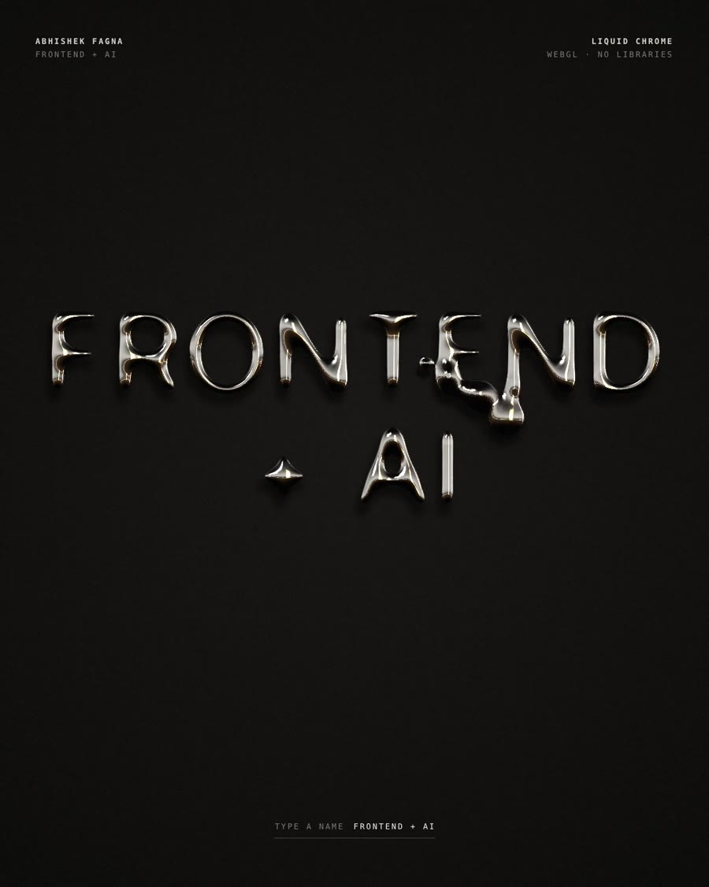

# liquid-chrome

Type a name and it turns into liquid chrome. A drop of mercury follows your cursor, melts into the letters and pulls them along. Type a new name and the metal flows into the new word.

One HTML file. WebGL2 and plain JavaScript. No Three.js, no GSAP, no 3D models, no images.

## How it works

1. **Letters become a field.** The text is drawn on a hidden canvas and blurred, which gives a smooth grid of numbers between 0 and 1.
2. **Drops are added to the field.** Each mercury drop adds a soft bump (a metaball). Because the drops and letters are added into the same field, they merge like real liquid instead of just overlapping.
3. **The surface is where the field crosses 0.5.** The fragment shader checks every pixel. Above 0.5 is metal, below is background.
4. **Shape comes from the slope.** How fast the field changes around a pixel tells the shader which way that bit of surface is facing.
5. **Chrome is just reflections.** Each pixel reflects a made-up photo studio: bright softboxes, a horizon line and a dark floor. Strong bright and dark next to each other is what makes it read as metal.
6. **Morphing between names** blends the old field into the new one, with a little extra ripple, so the metal pours from one word to the next.

## Run it

Open `index.html` in a browser. That's it.

## Deploy

It's a static file, so any static host works. On Vercel: import this repo and deploy with the default settings.

---

Built by [Abhishek Fagna](https://github.com/Abhishekfagna), frontend engineer building with AI.
